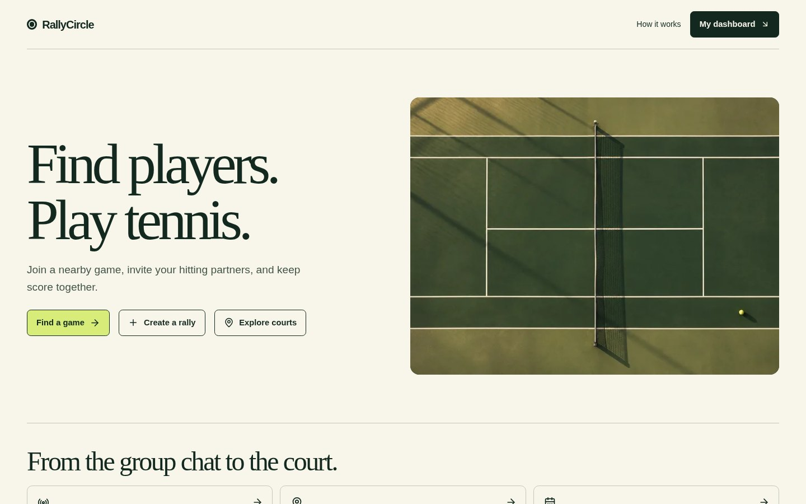

# RallyCircle

RallyCircle helps tennis players find a court, organize a rally, and play a match. Hosts share one link for RSVPs, waitlists, chat, Courtboard, and scoring.

I built RallyCircle to answer the question that gets lost in group chats: do we have enough players to play? In a doubles rally, the attendance panel shows **Doubles ready!** when it counts four distinct confirmed players.



## Experience the core workflow

Follow the [60-second reviewer demo](docs/reviewer-demo.md) to discover a court, create a doubles rally, watch the fourth confirmation, and score a point. The live walkthrough requires an approved disposable DeepSpace app and four test accounts. The signed-out landing and sign-in gate can be explored locally.

## How it works

- React and Vite render the app. A Hono router on Cloudflare Workers handles HTTP, and DeepSpace supplies OAuth, record subscriptions, messaging, and presence.
- Attendance commands use verified identity and serialize writes per rally. Capacity counts distinct players, and a freed seat goes to the next eligible player in the waitlist. The attendance panel derives readiness from the same RSVP subscription that feeds the roster.
- Match scores use revisions to detect stale writes. Player statistics count confirmed results and exclude disputed or pending results.
- Court search combines OpenStreetMap discovery with curated venues. [OpenStreetMap attribution](https://www.openstreetmap.org/copyright)

## Run the public checks

Use Node 24 and npm 11.6 or newer.

```sh
npm ci
npm run validate
npm run lint
node --test tests/*.test.mjs
npm run build
npx playwright install chromium
npm run test:public
```

For a signed-out preview, run `npm exec -- vite --host 127.0.0.1` and open the local URL it prints. For authenticated verification, use the [release checklist](docs/final-release-checklist.md) and the [official DeepSpace testing guide](https://docs.deep.space/guides/testing). Keep CLI state, local variables, and account files out of Git.

The public browser suite exercises the signed-out app. Local command tests use a harness for the storage and recovery paths. Authenticated multi-account behavior, hosted alarm recovery, and legacy migration compatibility remain release gates. The [review notes](docs/reviewer-demo.md#verification) record the evidence and its limits.
