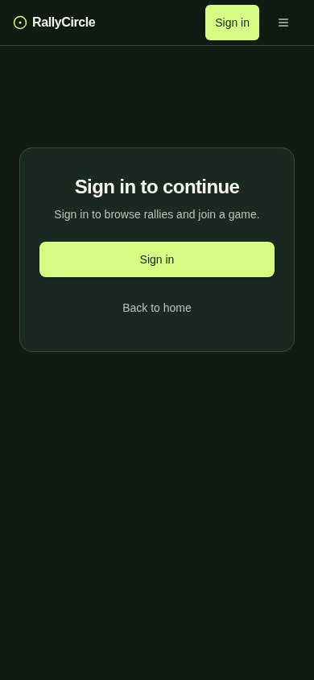

# 60-second RallyCircle reviewer demo

Use the exact reviewed commit in an approved disposable DeepSpace app. For the timed run, have four authorized test identities signed in in separate browser profiles. Arrange the host and one player side by side and have the other two profiles ready. Use a real court from search. Sign-in and setup are outside the timer.

| Time | Action | What to look for |
| --- | --- | --- |
| 0:00–0:12 | In Courts, open a court and start a rally from it. | The court carries into the creation form. |
| 0:12–0:27 | Create a future doubles rally with target and capacity both set to four. Confirm the host RSVP, then share the invite. | Check that the host is counted once. |
| 0:27–0:47 | Open the invite in the three player profiles. Confirm the first two and leave one player's rally view open beside the host's. Confirm the final RSVP from the fourth profile. | Both observer screens should go from three confirmed to **Doubles ready!**, without a reload. |
| 0:47–1:00 | In the host's Match tab, choose the two doubles sides, start scoring and enter one point. | The point appears on the scoreboard. |

Rehearse before recording. If the readiness badge or score fails to update, record the exact SHA, step, and browser logs with private data redacted. Keep the timing honest and omit the live segment from a submission until it passes. With two accounts you can test invite return, RSVPs and sync, but the doubles transition needs four distinct accounts.

## Verification

- **Public browser evidence.** The README desktop capture and the mobile sign-in gate below come from Chromium against the running local app. No sample player or match data was inserted.
- **Local logic evidence.** The attendance regression covers duplicate rows, a player marked Maybe, a fourth distinct confirmation, and withdrawal. Existing server tests cover capacity and waitlist promotion. These tests do not exercise the hosted subscription.
- **Live evidence pending.** DeepSpace returned `not_authenticated` in this workspace. The OAuth invite round-trip, four-account transition, live scoring, and the two-account release checklist remain pending on a disposable app. Local recovery tests also leave real Durable Object alarms and legacy schema upgrades unverified. Preserve [9a032ca](https://github.com/jbejaran-bit/rallycircle-deepspace/commit/9a032ca) as the fallback.

